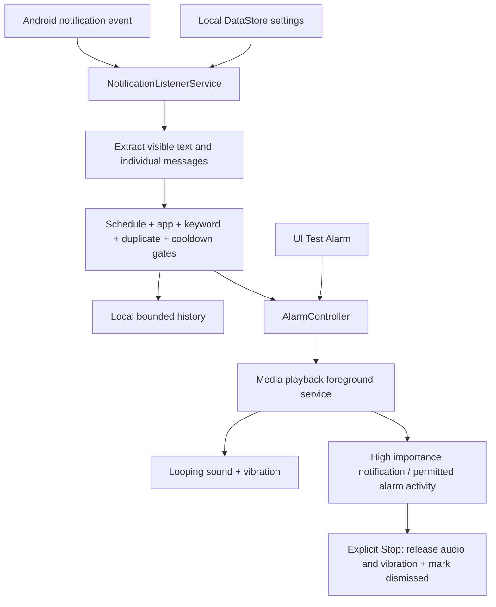

# Sleep Guard

**Sleep through the noise. Wake up for your mentions.**

[](https://github.com/sakibesrat71/sleep-guard/actions/workflows/android.yml)

A small, privacy-focused Android application that watches **Microsoft Teams** and **Slack** notifications during your sleep window. When visible notification text contains an enabled keyword, it starts a repeating alarm and vibration, with lock-screen controls where Android permits them.

Built as a Kotlin / Jetpack Compose portfolio project with explicit platform limitations, independently testable detection logic, and no server infrastructure. **V1 requires real-device validation before relying on it for a wake-up.**

## Features

- Overnight or same-day sleep windows, plus Monitor all day.
- Independently enable Teams and Slack; add, disable, and delete personal keywords.
- Case-insensitive substring matching with whitespace normalization; no AI or fuzzy matching.
- Notification titles, text, expanded text, conversation metadata, sender names, text lines, safe custom text extras, and individual MessagingStyle entries.
- Five-minute duplicate cache, plus a separate optional conversation cooldown.
- Looping alarm audio using alarm AudioAttributes, generated fallback tone, repeating vibration, and explicit STOP controls.
- Original notification destination when available; installed-app launch fallback.
- Local history of the most recent 100 triggers with dismissal status and clearing.
- First-launch onboarding, permission readiness, Samsung guidance, and immediate / 10-second delayed alarm tests.

## Privacy

The installed application has **no INTERNET permission**. Notification contents never leave the device. There are no accounts, analytics, advertising SDKs, Firebase, cloud databases, AI APIs, Teams/Slack authentication, Accessibility access, scraping, or database inspection. Build-time dependency downloads and GitHub CI do not process personal notifications.

Settings and history use Preferences DataStore in private app storage. History deliberately contains available sender and message details; clear it in Recent Alerts. Android backup is disabled, with explicit exclusions for cloud backup and device transfer. Uninstalling deletes app data. Full-screen alarm details can be visible on the lock screen; notification previews omit message bodies. Debug logs contain only generic processing outcomes, not message text or exception details.

Notification Access is a broad Android grant. Sleep Guard checks the supported / selected package before extracting text. Supported package names are [`com.microsoft.teams`](https://play.google.com/store/apps/details?id=com.microsoft.teams) and [`com.Slack`](https://play.google.com/store/apps/details?id=com.Slack).

## Build and run

1. Open this directory in Android Studio with support for AGP 8.10.1 and API 36.
2. Install Android SDK Platform 36 and SDK Build-Tools 35.0.0. The project uses `compileSdk = targetSdk = 36`, the stable SDK installed and validated in the build environment. Minimum SDK is 28 (Android 9).
3. Use JDK 17 or newer compatible with Gradle 8.14.3; Android Studio's JDK is recommended. Local compilation also validated with JDK 23.
4. Let Studio create `local.properties` with your SDK path, or set `ANDROID_HOME`. Machine-specific paths are excluded from Git.
5. Run:

```sh
./gradlew :app:assembleDebug :app:testDebugUnitTest :app:lintDebug
```

On Windows use `gradlew.bat`. Install with Android Studio or:

```sh
adb install -r app/build/outputs/apk/debug/app-debug.apk
```

APK: `app/build/outputs/apk/debug/app-debug.apk`. Test report: `app/build/reports/tests/testDebugUnitTest/index.html`. Lint report: `app/build/reports/lint-results-debug.html`. Debug APKs are for development, not a signed Play Store release. CI uploads its APK and test/lint reports as workflow artifacts.

## Setup on the phone

1. Allow notifications on Android 13+.
2. Grant Sleep Guard Notification Access.
3. Exempt Sleep Guard from battery optimisation. This is distinct from Notification Access and is important for background foreground-service starts.
4. On Android 14+, review full-screen alarm access. In the alarm channel, retain high importance and allow lock-screen notifications.
5. Raise the **alarm** volume manually. Sleep Guard does not change device volume.
6. In DND settings, allow alarms. Notification Policy Access is optional; Sleep Guard never enables/disables DND. When allowed, it requests DND bypass for its channel, subject to Android and user channel settings.
7. Enable Teams / Slack notifications and message previews. Choose keywords and sleep times, then enable the guard.
8. Test while unlocked and locked, including the delayed 10-second test. A successful foreground test alone does not prove background delivery.

### Samsung Galaxy S24 Ultra

Settings paths vary with One UI. Look for Apps → Sleep Guard → Battery → **Unrestricted**. Under Battery → Background usage limits, remove Sleep Guard from **Sleeping** and **Deep sleeping** apps and add it to **Never sleeping** apps if offered. Also check battery optimisation exemption, Notification Access, notification channels, full-screen access, and DND separately. Recheck after OS/app updates and reboot. Enterprise / work-profile policy can block listener access to work notifications.

## Architecture



Packages:

| Package | Responsibility |
|---|---|
| `model` | Serializable settings/history and notification events; supported app registry |
| `logic` | Pure schedule, matcher, fingerprint, cooldown, and processing rules |
| `data` | Transactional DataStore settings and bounded alert history |
| `notifications` | Event-driven Android listener and defensive text extraction |
| `alarm` | Shared test/real flow, foreground playback, notification, lock-screen UI, stop receiver |
| `ui` | Compose screens, first-launch guidance, permission checks |

Repositories are shared by a small Application object. No DI framework, Room database, permanent monitoring foreground service, polling, or periodic notification scan. A coroutine serializes incoming notification processing. Only alarm activation briefly acquires a timed CPU wake lock; MediaPlayer manages wakefulness for playback.

`MentionMatcher` is a small interface for future matching implementations; V1 uses only `KeywordMatcher`. Keyword order decides the displayed first match. All matches are literal substrings: `Sakib` also matches `Sakibul`; choose sufficiently specific keywords.

## Detection semantics

- Schedule uses current phone local time. Start is inclusive, end exclusive. Equal times mean an empty window; Monitor all day means 24 hours. DST/timezone changes follow local wall time.
- Identical notification content in the same notification identity is suppressed for five minutes. Repost timestamps are excluded. MessagingStyle identities include each message's timestamp, sender, and text so a genuinely new identical-text message with a new timestamp can trigger.
- Cache is in memory, bounded to 2,048 entries; process death clears it. Apps that change IDs or message timestamps can make duplicates indistinguishable from new messages. The optional conversation cooldown helps when conversation metadata is available.
- Cooldown defaults to disabled. With it enabled, new messages in the same known conversation are intentionally suppressed for the configured interval. Unknown conversations do not share a guessed cooldown bucket.
- Multiple matching messages arriving during an alarm add history entries and update the current alarm session. One STOP action dismisses the entire active session. Open App keeps the alarm playing.
- The listener does not enumerate active/old notifications on connect. Reposted notifications predating its connection are ignored. Settings survive reboot; alarms are non-sticky and are not restarted from history.
- Text extraction is bounded and defensive. Missing text is ignored. MessagingStyle entries are examined individually so aggregate notification history does not re-trigger old matches on every update.

## Permissions and exposure

| Permission / grant | Why |
|---|---|
| `POST_NOTIFICATIONS` | Alarm notification; requested at runtime on API 33+ |
| Notification Access | System binds the notification listener after user approval |
| `VIBRATE` | Repeating alarm vibration |
| `WAKE_LOCK` | Brief activation and MediaPlayer playback wakefulness; released on stop |
| `FOREGROUND_SERVICE` | Visible service only while an alarm plays |
| `FOREGROUND_SERVICE_MEDIA_PLAYBACK` | API 34+ type-specific permission for alarm audio |
| `USE_FULL_SCREEN_INTENT` | Alarm UI where user / Android permit it |
| `ACCESS_NOTIFICATION_POLICY` | Optional channel DND bypass; no global DND changes |

The listener is exported **only** under Android's signature `BIND_NOTIFICATION_LISTENER_SERVICE` permission. Launcher is exported to open the app. Alarm activity, playback service, and stop receiver are not exported. Internal alarm intents do not accept arbitrary alert text from other apps. PendingIntents are immutable. Package visibility queries are limited to Teams and Slack. No exact-alarm, accessibility, overlay, location, microphone, or internet permissions are requested. No boot receiver is needed: Android manages listener reconnection after unlock.

## Platform limits

Android 12+ restricts foreground-service starts from the background. Battery optimisation exemption is one documented allowance. If Android rejects a start, Sleep Guard posts a fallback alarm notification; opening it starts playback from a visible activity. **Fallback notification delivery does not guarantee repeating audio before interaction.** If notifications are denied too, that fallback can be invisible.

Android 14+ restricts full-screen intents. The user or store can deny them; an unlocked phone usually shows a heads-up notification instead. Alarm playback respects alarm volume, audio routing, DND and platform controls. Existing notification-channel choices belong to the user. OEM power management, force-stop, reboot, process termination, disabled channels, or unavailable previews can prevent detection or end playback. Hidden notification text cannot be recovered. Sideload/build success does not establish Play Store policy approval.

Relevant official documentation: [background service start restrictions](https://developer.android.com/develop/background-work/services/fgs/restrictions-bg-start), [Android 14 full-screen changes](https://developer.android.com/about/versions/14/behavior-changes-14), [notification listeners](https://developer.android.com/reference/android/service/notification/NotificationListenerService), [foreground service types](https://developer.android.com/develop/background-work/services/fgs/service-types).

## Manual V1 acceptance test

Run on your Samsung S24 Ultra; record Android / One UI versions and actual results. Hardware behaviour has not been claimed as validated.

1. Install; grant notification permission and Notification Access; apply setup/battery guidance.
2. Set Monitor all day, add `Sakib Esrat`, enable Teams, enable guard.
3. Send a Teams message: `Sakib Esrat can you please check the deployment`.
4. Confirm immediate detection, looping sound, vibration, source/sender/message, and Stop controls.
5. Press STOP; verify audio/vibration cease, notification disappears, history is dismissed.
6. Repost/update the same notification without changing message content or identity within five minutes; expect suppression.
7. Send `Deployment completed successfully`; expect no alarm.
8. Send a genuinely new matching message; expect a new alarm. Repeat with Slack.
9. Lock phone and repeat steps 3–7. Test the 10-second delayed Test Alarm while locked.
10. Test DND on with alarms allowed, then alarms disallowed; record sound/vibration/full-screen behaviour.
11. Test at start and end boundaries and across midnight; test Monitor all day.
12. Disable guard, app selection, and a keyword individually; verify suppression.
13. Reboot, unlock once, verify settings and listener reconnect, and send a **new** matching message. Old history must not start an alarm on reboot.
14. Test hidden previews / muted channels / network delays; confirm the limitation is understood.
15. Test cooldown with two new messages in the same conversation; disable cooldown and repeat.
16. Test two mentions during one alarm, original destination and missing/cancelled PendingIntent fallback, denied full-screen access, low alarm volume, battery optimisation, and an overnight idle run.

Automated tests cover schedule boundaries, normalized matching, duplicates/expiry, cooldown, notification gates, the central deployment-mention example, defensive extras parsing, and MessagingStyle separation. Automated checks cannot validate Samsung audio, lock screen, DND, notification delivery, or overnight battery behaviour.

## Scope

V1 intentionally has no AI, accounts, cloud sync, authentication integrations, machine learning, or notification-history scraping. Adding a monitored app requires updating the registry, package visibility, UI documentation, and tests. Reliable local detection and explicit platform limitations take priority over extra features.

## License

MIT. The bundled fallback tone is generated for this project; it contains no third-party audio samples. Microsoft Teams and Slack names are used only to identify supported applications; this project is not affiliated with either company.
